# TSG Flow — pipeline de definição e execução

O fluxo de definição transforma visão de produto em tarefas executáveis. O fluxo de execução
consome essas tarefas uma por vez, protegendo cada entrega com gate, validação e checkpoint.

```mermaid
%%{init: {"theme":"base","flowchart":{"curve":"linear"}}}%%
flowchart LR
    subgraph product["tsg-flow-product · docs/product/"]
        vision["Visão"]:::definition
        domainMap["Domain Map<br/>bounded contexts"]:::definition
        architectureBaseline["Baseline<br/>regras estruturais"]:::definition
        capabilityBacklog["Backlog<br/>capacidades CAP"]:::definition
        vision --> domainMap --> architectureBaseline --> capabilityBacklog
    end

    subgraph next["tsg-flow-next · por capacidade · work/&lt;cap&gt;/"]
        domain["Domain doc<br/>(2+ PRDs no domínio)"]:::definition
        prd["PRD<br/>o quê e por quê"]:::definition
        apiDecision{"Integração nova<br/>ou alterada?"}:::decision
        contract["Contrato<br/>OpenAPI / AsyncAPI / ODCS"]:::apiDoc
        techspec["TechSpec<br/>backend, frontend ou full-stack"]:::definition
        tasks["Tasks<br/>fatias verticais"]:::definition

        domain -.-> prd
        prd --> apiDecision
        apiDecision -->|sim| contract --> techspec
        apiDecision -->|não| techspec
        techspec --> tasks
    end

    capabilityBacklog --> domain
    capabilityBacklog --> prd

    subgraph execution["Execução por task"]
        orchestrator["Orchestrator<br/>coordena"]:::execution
        implementer["Implementer<br/>uma task"]:::execution
        focusedValidator["Validator<br/>focused / revalidation"]:::validation
        integrator["Integrator<br/>checkpoint-task"]:::execution
        taskDone["Task aprovada<br/>status done"]:::done
        fullValidator["Validator<br/>full do PRD"]:::validation
        prepare["Integrator<br/>prepare-integration"]:::execution
        reopen["Integrator<br/>reopen-task"]:::execution
        complete["Integrator<br/>complete-prd"]:::done
        blocked["Intervenção humana<br/>status blocked"]:::blocked

        orchestrator -->|próxima task| implementer
        implementer -->|implementação pronta| focusedValidator
        focusedValidator -->|reprovada e há tentativa| implementer
        focusedValidator -->|aprovada| integrator
        integrator --> taskDone
        taskDone -->|ainda há tasks| orchestrator
        orchestrator -->|todas as tasks concluídas| prepare
        prepare -->|branch atualizada| fullValidator
        fullValidator -->|bloqueio atribuível a task| reopen
        reopen -->|corrigir e revalidar| implementer
        fullValidator -->|FULL VALIDATION APROVADA| complete
        complete -->|base ou código mudou| prepare
        focusedValidator -->|preflight, limite ou bloqueio| blocked
        fullValidator -->|limite de correção| blocked
    end

    repo["Repositório alvo<br/>stack + CI"]:::input
    gate["Gate da task<br/>comando do projeto"]:::gate
    adrs["docs/adr/<br/>decisões duráveis"]:::apiDoc
    architectureBaseline -.->|consulta / registra decisões| adrs
    techspec -.-> adrs

    tasks --> orchestrator
    repo --> gate
    tasks -.->|declara comando e expectativa| gate
    implementer -.->|executa; exit code decide| gate
    focusedValidator -.->|executa; exit code decide| gate
    fullValidator -.->|suíte completa do projeto| gate

    classDef input fill:#f4f4f5,stroke:#52525b,color:#18181b
    classDef definition fill:#dbeafe,stroke:#2563eb,color:#172554
    classDef decision fill:#fef3c7,stroke:#d97706,color:#451a03
    classDef apiDoc fill:#dcfce7,stroke:#16a34a,color:#14532d
    classDef execution fill:#e0e7ff,stroke:#4f46e5,color:#1e1b4b
    classDef validation fill:#ffedd5,stroke:#ea580c,color:#431407
    classDef gate fill:#ccfbf1,stroke:#0f766e,color:#134e4a
    classDef done fill:#dcfce7,stroke:#15803d,color:#14532d
    classDef blocked fill:#fee2e2,stroke:#dc2626,color:#450a0a
```

## Legenda

- **Três pontos de entrada:** `tsg-flow-product` (uma vez por produto), `tsg-flow-next` (por
  capacidade, até o plano aprovado) e `tsg-flow-orchestrator` (execução).
- **Durável em `docs/`, entrega em `work/`.** Estado de produto em `docs/product/flow-state.json`;
  estado de execução em `work/<cap>/run-state.json`.
- **Domain doc** só nasce quando o domínio tem 2+ PRDs no horizonte visível; senão as regras vão no PRD.
- **Contrato** sai do PRD e antecede a TechSpec; feature sem integração declara N/A.
- **TechSpec e tasks** são dispensadas em escopo Médio, que segue o fluxo direto do projeto.
- **ADRs** ficam em `docs/adr/`, com numeração global, e sobrevivem à remoção do diretório da entrega.
- **Gate** é o comando real do projeto, executado pelos agentes de implementação e validação.
- **Full validation** ocorre depois dos checkpoints e da preparação da integração; mudança posterior
  de base ou código exige nova validação.
